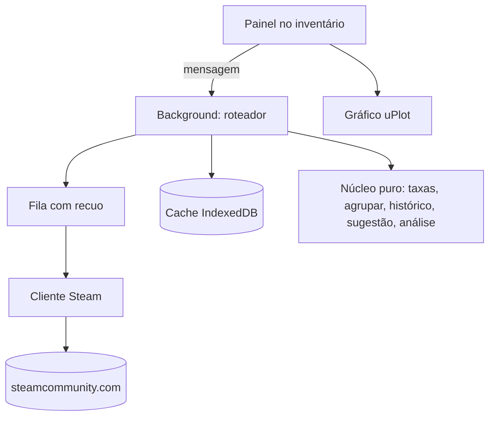

# Steam Vendas Design

**Spec**: `.specs/features/steam-vendas/spec.md`
**Status**: Draft

---

## Architecture Overview

Abordagem escolhida (recomendada): **content script faz as chamadas, background tem a fila e o cache**.

| Abordagem | Prós | Contras |
| --------- | ---- | ------- |
| A. Tudo no content script | Simples | Fila e cache somem ao trocar de página; várias abas furam o limite |
| **B. Content script (UI) + background (fila, cache, requisições)** | Uma fila única para todas as abas; cache persistente | Mensagens entre os dois |
| C. Página própria da extensão | Mais espaço para gráficos | Decisão do usuário foi painel no inventário |

Escolha: **B**. O background faz `fetch` para `steamcommunity.com` com `credentials: "include"`, usando a sessão do Firefox. O content script só desenha a interface e conversa por mensagens.



**Regra de ouro:** o núcleo (`src/core`) não importa DOM, `fetch` nem `browser.*`. Só funções puras, testadas contra fixtures reais.

---

## Code Reuse Analysis

Projeto novo, sem código a reaproveitar. Referências de padrão: o repositório `steam-historico` (mesmo autor, Steam) para parsing de resposta da Steam, a conferir na Fase 0.

| Integração | Método |
| ---------- | ------ |
| Steam (inventário, histórico, preços, ordens, venda) | `fetch` do background, cookies da sessão |
| Página do inventário | Content script em `steamcommunity.com/id/*/inventory*` e `/profiles/*/inventory*` |
| Ping (painel de status do usuário) | Não se aplica (extensão, não serviço) |

---

## Components

### core/taxas
- **Purpose**: converter preço do comprador em líquido e o inverso.
- **Location**: `src/core/taxas.ts`
- **Interfaces**: `liquido(compradorCentavos, regra): number`, `comprador(liquidoCentavos, regra): number`
- **Dependencies**: nenhuma. `regra` = taxa Steam, taxa do jogo, mínimo de 1 centavo cada (valores confirmados na Fase 0).

### core/agrupar
- **Purpose**: agrupar ativos vendáveis por `market_hash_name`.
- **Location**: `src/core/agrupar.ts`
- **Interfaces**: `agrupar(ativos: Ativo[]): Grupo[]`

### core/historico
- **Purpose**: ler o `pricehistory` e achar a mediana ponderada das ~50 últimas unidades.
- **Location**: `src/core/historico.ts`
- **Interfaces**: `parseHistorico(raw): Ponto[]`, `medianaUltimas(pontos, n = 50): { preco: number; amostra: number }`

### core/sugestao
- **Purpose**: preço sugerido por modo.
- **Location**: `src/core/sugestao.ts`
- **Interfaces**: `sugerir(modo: "rapido" | "equilibrado" | "paciente", ctx): { preco: number; base: string }`

### core/analise
- **Purpose**: tendência, volatilidade e spread.
- **Location**: `src/core/analise.ts`
- **Interfaces**: `analisar(pontos, janelaDias, ordens): Analise | "insuficiente"`

### steam/cliente
- **Purpose**: wrappers dos endpoints. Só monta URL, chama e valida o formato.
- **Location**: `src/steam/cliente.ts`
- **Interfaces**: `inventario(appid, ctx, steamid)`, `historico(appid, nome)`, `visaoGeral(appid, nome)`, `ordens(itemNameId)`, `vender(asset, liquidoCentavos)`

### background/fila
- **Purpose**: executar 1 requisição por vez, pausa mínima de 3 s e recuo exponencial em 429.
- **Location**: `src/background/fila.ts`
- **Interfaces**: `enfileirar<T>(tarefa): Promise<T>`, `cancelar(grupoId)`

### background/cache
- **Purpose**: cache com validade em IndexedDB.
- **Location**: `src/background/cache.ts`
- **Interfaces**: `obter(chave, ttlMs)`, `guardar(chave, valor)`

### background/venda-lote
- **Purpose**: vender N ativos, pulando recusados e permitindo cancelar.
- **Location**: `src/background/venda-lote.ts`
- **Interfaces**: `iniciarLote(ativos, liquidoCentavos, onProgresso)`, `cancelarLote()`

### content/painel, lista-grupos, detalhe-preco, grafico, lote
- **Purpose**: interface. `painel` monta o contêiner só no próprio inventário; `lista-grupos` mostra os grupos; `detalhe-preco` mostra preços e sugestões; `grafico` usa uPlot; `lote` confirma e mostra o progresso.
- **Location**: `src/content/*.ts`

---

## Data Models

```typescript
interface Ativo { assetid: string; appid: number; contextid: string; market_hash_name: string; marketable: boolean }
interface Grupo { nome: string; appid: number; ativos: Ativo[]; contagem: number }
interface Ponto { t: number; preco: number; volume: number }   // preço em centavos, t em ms
interface Analise { tendenciaPct: number; volatilidade: number; spread: number }
```

---

## Error Handling Strategy

| Cenário | Tratamento | O que o usuário vê |
| ------- | ---------- | ------------------ |
| 429 | Pausa a fila, recuo 3 s, 6 s, 12 s... até 60 s | "aguardando limite da Steam" |
| Sessão expirada (401/redirect ao login) | Para a fila | "entre na Steam e recarregue" |
| Formato de resposta mudou | Validação no cliente falha | "resposta inesperada da Steam" e nada é vendido |
| Venda recusada | Registra motivo, segue | Lista de recusados no fim |
| Cache corrompido | Descarta a entrada | Nada, refaz a busca |

---

## Risks & Concerns

| Concern | Location | Impact | Mitigation |
| ------- | -------- | ------ | ---------- |
| Endpoints não documentados podem mudar | `src/steam/cliente.ts` | Quebra silenciosa ou venda com preço errado | Validação de formato; fixtures reais; Fase 0 antes de tudo |
| Arredondamento de taxa errado vira prejuízo | `src/core/taxas.ts` | Líquido diferente do mostrado pela Steam | Tabela 1–10000 centavos contra fixtures; envio exige confirmação com o líquido na tela |
| Automação perto das regras da Steam | `src/background/venda-lote.ts` | Risco à conta | Sem repricing, clique por lote, pausa de 3 s |
| Limite de requisições | `src/background/fila.ts` | 429 em cascata | Fila única, cache, preços sob demanda |
| Fatos da Steam vêm de memória, não conferidos | toda a spec | Premissa falsa | Fase 0 valida antes de qualquer código de produto |

---

## Tech Decisions

| Decisão | Escolha | Racional |
| ------- | ------- | -------- |
| Linguagem | TypeScript | Tipos para respostas da Steam |
| Build | esbuild (IIFE) + `web-ext` | Content script precisa ser bundle clássico; o Rollup do Vite não gera IIFE com várias entradas |
| Testes | Vitest, `fake-indexeddb`, jsdom | Núcleo sem DOM; UI com jsdom |
| Gráfico | uPlot | Leve, bom para séries temporais |
| Dinheiro | Inteiros em centavos | Evita erro de ponto flutuante |
| Contexto da página | `window.wrappedJSObject` (`g_steamID`, `g_sessionID`, `g_rgWalletInfo`, `g_bViewingOwnProfile`) | Firefox; a verificar na página real |
| Taxas | Porte do JS público da Steam, testado contra ele como oráculo | O percentual do jogo pode variar por item (a confirmar na captura) |
| Inventário e venda | Passam pela fila do background | Respeita o ritmo único de requisições |
| Manifest | MV3 com `background.scripts` (event page) | É o que o Firefox suporta; a conferir na Fase 0 |
